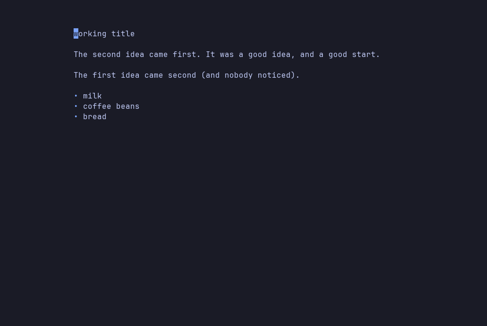
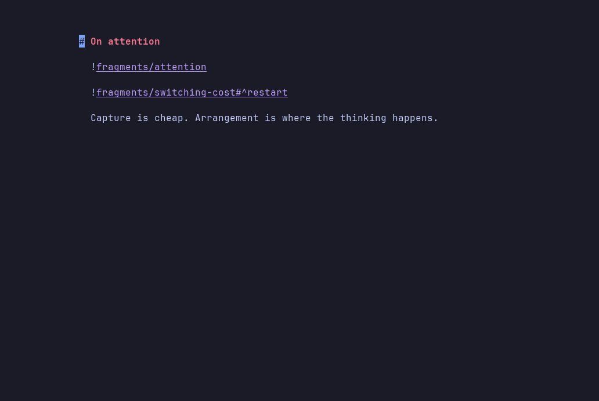
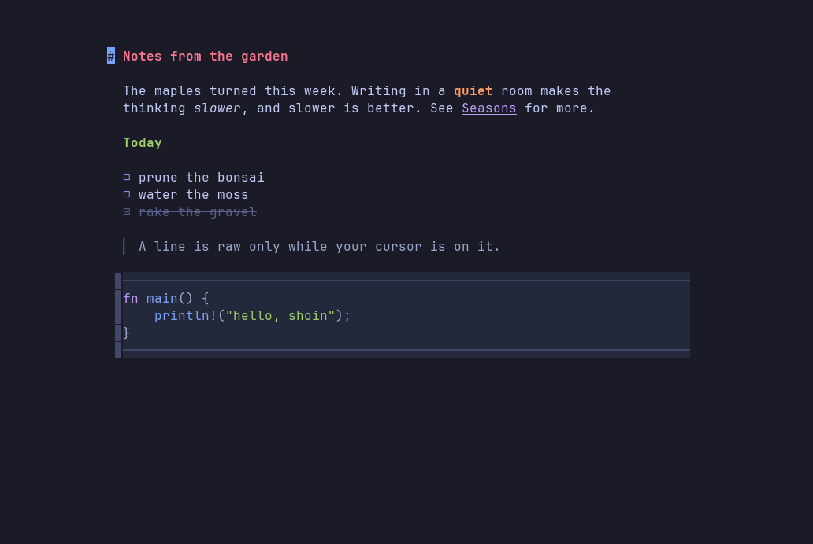

<h1 align="center">Shoin</h1>

<p align="center">
  <em>A no-clutter terminal Markdown editor.</em><br>
  Modal editing, Obsidian-style live formatting, an iA&nbsp;Writer surface —
  one centered column of text and nothing else.
</p>

<p align="center">
  <a href="https://github.com/nol00p/shoin/actions/workflows/ci.yml"></a>
  
  
  <a href="https://cli.masoko.net/tools/shoin/"></a>
</p>

<p align="center">
  
</p>

*Shoin* (書院) is the study alcove of a traditional Japanese house: a writing
desk built into a bay by the window, and nothing else in the room.

---

## Why Shoin

- **No permanent interface.** Text in a centered column and nothing else. The
  file tree, finder and splits open on a key and close on the same key.
  → [Panels](docs/panels.md)
- **Live preview that never lies.** The line under the cursor shows raw
  Markdown; every other line shows the finished text.
  → [Live preview](docs/live-preview.md)
- **Vim grammar, plus writer verbs.** Operators, motions, text objects, counts,
  registers and `.` — and `gb` for bold, `gt` to tick a task, `g1`–`g6` for
  headings. → [Editing](docs/editing.md) · [Writing](docs/writing.md)
- **Notes that compose.** `[[links]]` you walk with `gf`, `![[embeds]]` that
  pull one note into another, and export to Markdown, text, HTML or PDF.
  → [Notes](docs/notes.md) · [Export](docs/export.md)
- **Careful with your files.** Atomic saves, no autosave unless you ask, and
  a merge view when something else edits a file you're working on.
  → [Files](docs/files.md)
- **Plain config, hot-reloaded.** A folder of TOML files; save one and the
  running editor updates. → [Configuration](docs/configuration.md)

`.md` and `.txt` only. It is not a code editor, though fenced code blocks are
highlighted in seventeen languages.

## See it work

**Editing prose with Vim's grammar** — `ciw` and `.`, moving a paragraph with
`dap` and `p`, `ci(`, list items that continue themselves, undo and redo.

<p align="center">
  
</p>

**Composing a text from notes** — two notes embedded in an essay, `:embed full`
to read it without seams, `gf` to follow a link, and a new note created from a
link that didn't resolve yet.

<p align="center">
  
</p>

**A tour** — writer verbs, Insert mode, focus mode and the file tree.

<p align="center">
  
</p>

---

## Install

Shoin runs on **macOS and Linux**, on x86_64 and ARM. Windows isn't
supported yet: it isn't built or tested there.

The installer fetches a prebuilt binary:

```sh
curl --proto '=https' --tlsv1.2 -LsSf https://github.com/nol00p/shoin/releases/latest/download/shoin-installer.sh | sh
```

Or build it with Cargo (Rust 1.88 or newer): `cargo install shoin`.

It works with no config: the leader keys, such as `Space fe` for the file
tree, are built in. `shoin --init-config` writes an annotated copy of the
config to `~/.config/shoin/` when you want to change it. You need a
truecolor terminal and a [Nerd Font](https://www.nerdfonts.com/) (or
`glyphs.nerd_fonts = false`). [Getting started](docs/getting-started.md)
covers the other ways to install and the optional PDF tools.

## First five minutes

```sh
shoin notes.md     # open a file; it's created on the first :w
shoin -p notes.md  # print it as the editor shows it (add --pager to scroll)
shoin              # a blank page with a few ways in drawn on it
```

| Do this | Press |
|---|---|
| Type, then stop typing | `i` … `Esc` (or `jk`) |
| Save, quit | `:w`, `:q` |
| Bold the word under the cursor | `gb` |
| Open the file tree | `Space fe` |
| Follow a `[[link]]`, then come back | `gf`, then `Ctrl-^` |
| Dim everything but this paragraph | `:focus paragraph` |
| See every key on one page | `Space hl` |

`:help` inside the editor explains the rest: `:help bindings`,
`:help commands`, `:help writer` and `:help config`.

## Documentation

- [Getting started](docs/getting-started.md) — install, requirements, first run
- [Live preview](docs/live-preview.md) — how concealment works
- [Editing](docs/editing.md) — motions, operators, text objects, registers
- [Clipboard](docs/clipboard.md) — system clipboard, SSH, pasting
- [Writing](docs/writing.md) — writer verbs, focus, typewriter and zen modes
- [Panels](docs/panels.md) — file tree, finder, buffers, splits
- [Notes](docs/notes.md) — links, embeds, `gf`, pictures
- [Export](docs/export.md) — Markdown, text, HTML, PDF, from the editor or the shell
- [Files](docs/files.md) — saving, autosave, outside edits and `:diff`
- [Configuration](docs/configuration.md) — the config folder, themes, key bindings
- [Design notes](docs/design.md) — why Shoin works the way it does
- Reference: [keys](docs/reference/keys.md) · [commands](docs/reference/commands.md) · [command line](docs/reference/cli.md)
- [Changelog](CHANGELOG.md)

## License

Licensed under the **Apache License, Version 2.0**. See [LICENSE](LICENSE), or
<https://www.apache.org/licenses/LICENSE-2.0>.

Unless you state otherwise, any contribution you intentionally submit for
inclusion in this work is licensed as above, per section 5 of the License, with
no additional terms.

Every dependency is permissively licensed — MIT, Apache-2.0, ISC, Zlib,
Unlicense or CC0 — so nothing in the tree conflicts with distributing Shoin
under Apache-2.0.
