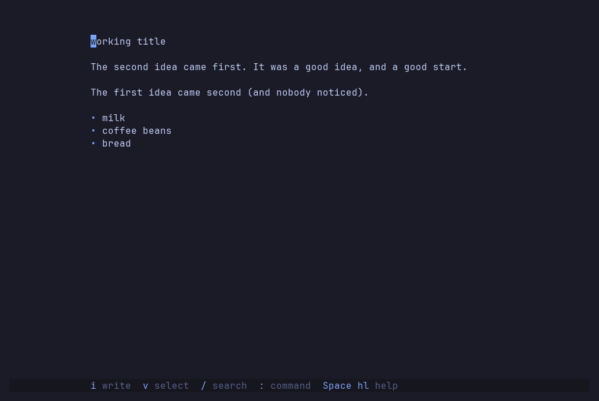

# Editing

<p align="center">
  
</p>

Shoin's editing is Vim's: modes, operators that take motions and text objects,
counts, registers, undo and `.` repeat. If you know Vim, your hands already
know Shoin; the full list is in the [key reference](reference/keys.md).

## Modes

- **Normal** — move around and run operators. `Esc` always returns here.
- **Insert** — type text. Enter it with `i` `a` `I` `A` `o` `O`; leave with
  `Esc`, `Ctrl-c` or `jk`.
- **Visual** — select text: `v` by character, `V` by line, or drag the mouse.
- **Command** — the `:` line, with `Tab` completion (see
  [The command line](#the-command-line)). **Search** — `/` forward, `?`
  backward.

## Getting around

```
  h j k l / arrows   move             i / a        insert / append
  w b e              by word          o / O        open a line below / above
  0 ^ $              line start/end   x            delete a character
  gg / G             top / bottom     dd yy p      delete / yank / paste
  { }                by paragraph     .            repeat the last change
  u / Ctrl-r         undo / redo      / ? n N      search
```

## Operators, objects and counts

Operators take motions, text objects and counts the way you'd expect: `d2w`,
`ciw`, `ya(`, `>ip`, `gUiw`, `2d3w` (counts multiply, so that deletes six
words). Doubling an operator acts on the whole line: `dd`, `cc`, `yy`.

Text objects work after an operator or in Visual mode: `iw`/`aw` for a word,
`is`/`as` a sentence, `ip`/`ap` a paragraph, `i"` inside quotes, `i(` `i[`
`i{` `i<` inside brackets (which may span lines).

## Lists

A list item is a text object too. `al` is the item with its continuation
lines and everything nested under it, `il` is the item without its sub-items,
`aL` is every item at the same level, each with its sub-items, and `iL` is
the item under the cursor through the last item at its level. So `>al`
nests an item under the one above it and takes its sub-items along, `<al`
brings it back out, `dal` deletes the whole item, `>aL` indents a whole
nested level at once, and `diL` deletes the rest of a list.

`Alt-j` and `Alt-k` move the item under the cursor past the next or previous
item, its sub-items travelling with it; `3 Alt-j` moves it past three. An
item never leaves its list this way: at the first or last item the move is
refused, and `<al` is how it moves out. In Visual mode, `Alt-j` and `Alt-k`
move every item the selection touches as one block, and the selection stays
on it for the next press.

Numbered lists stay in sequence: when an item moves, or moves into or out of
a `1.` `2.` `3.` list, the numbers of each list it touched are rewritten, in
the same undo step. Bullet lists are never changed. Turn this off with `list_renumber = false`
in `[editor]`. Renumbering never re-indents the lines under an item, which
matters once a list reaches `10.`: see Details for how to write long
numbered lists so other tools read them as Shoin shows them.

`:fixlist` re-indents the list under the cursor so that GitHub, pandoc and
export read it the way Shoin shows it: whatever sits under an item moves to
the column where the item's text starts, taking its own sub-items along. It
only runs when you ask, on the whole list around the cursor, as one undo
step. In Visual mode it re-indents every list the selection touches, still
as one undo step. To put it on a key, bind `fix_list` under `[keys.normal]`.

A list inside a blockquote (`> - a`) works the same way: every command
above, `Tab`, and `Enter`, which continues `> - a` with `> - `. The `>`
markers stay as written.

In Insert mode, `Tab` and `Shift-Tab` do the same as `>al` and `<al` on an
item's line, so `Enter`, `Tab`, and typing starts a sub-item.

An indent that would break the list is refused with a message and changes
nothing (see Details). Each command is one undo step and `.` repeats it.

## Registers

`"ayy` yanks into register `a` and `"ap` pastes from it; `"A` appends to it.
`"0` holds the last yank, which a delete never overwrites, and `"1`–`"9` are
the delete ring, newest first. `"+` is the system clipboard — see
[Clipboard](clipboard.md).

## The command line

`:` opens the command line. `Tab` completes the word you are typing: a
command's name, a path after `:e`, `:w`, `:saveas` and `:wq`, an option or
its value after `:set`, a topic after `:help`, an open buffer after `:b`, and
the values `:focus`, `:align`, `:embed`, `:number` and `:export` take. `Tab`
again puts in the next match and `Shift-Tab` the one before; past either end,
the line goes back to what you typed. The hint bar lists the matches. Every
command is in the [command reference](reference/commands.md).

A number goes to that line: `:42` is `42G`, on the line's first non-blank
character, and `:$` is the last line.

## Insert mode

`Enter` continues a list marker or a quote prefix, and ends the list when the
item is empty. On a list item's line, `Tab` nests the item under the one above
and `Shift-Tab` brings it back out, sub-items included, the same as `>al` and
`<al`; anywhere else `Tab` types a tab. `list_tab = false` in `[editor]` makes
`Tab` a tab on list items too. A terminal paste goes in exactly as copied: no
auto-indent, no list continuation, and a `jk` in the pasted text stays text.

## Folding

`zc` folds the list item under the cursor, with its sub-items, into its first
line. On a heading, or in the text under one, it folds the heading's section:
everything up to the next heading of the same or a higher level. The folded
line ends with ` … 5 lines`, the number of lines it hides.

```
  za        fold or unfold here       zR   unfold everything
  zc  zo    fold · unfold             zM   fold every item and section
```

`j` and `k` step over a fold as one line, and so do `Ctrl-d`, `Ctrl-u`,
`Ctrl-f` and `Ctrl-b`.
A search, `G`, `gg` or `:42` that lands inside a fold opens it. Each pane
folds on its own, so two panes on one file can show it folded differently.
Folds last until you quit. They are not saved and don't change the file or
its export.

In Visual mode, `zc` folds every item and section in the selected lines and
`zo` unfolds every fold there. [`examples/folding.md`](../examples/folding.md)
has sections and lists to try it on.

`zt`, `zz` and `zb` scroll the page so the cursor's line is at the top, the
middle or the bottom of the pane. The cursor stays where it is.

## Details

- `zc` folds the innermost item or section around the cursor that is still
  open, and moves the cursor to its first line. Pressed again, it folds the
  next one out. A fold inside a closed fold stays closed when the outer one
  opens. An item with no sub-items or continuation lines, or a heading with
  nothing under it, has nothing to fold.
- A section's fold stops before the blank lines in front of the next heading,
  so they stay on screen between the folded sections.
- `dd`, `yy`, `cc`, `>>` and `V` take a closed fold whole, and `3dd` counts
  it as one line. `p` on a folded line pastes below the whole fold.
- On a folded line, `o` opens a line below the whole fold and `O` one above
  it; the fold stays closed. `J` joins the folded line with the next line,
  the first one the fold hides, and the fold stays closed, as in vim. `J` in
  Visual mode joins a closed fold in the selection whole.
- `}` on a folded line starts after the fold, so the blank lines it hides
  don't stop it. A `}` or `{` that lands on a blank line inside a closed fold
  leaves the cursor on the folded line, and the fold stays closed.
- In Visual mode, `zc` works line by line from the top, as vim's does: it
  folds the innermost open item or section around a line, then goes on
  after it. On a line that is already folded it folds the next one out.
  `zo` opens each fold one level. Both end Visual mode and put the cursor at
  the start of the selection. `za` in Visual mode acts at the cursor only
  and keeps the selection.
- A new pane (`:split`, `Ctrl-w v`) starts with the folds of the pane it was
  split from. Lines added or removed in one pane move the folds of every
  pane on that file.
- A Normal-mode edit on a folded line, such as `~` or `r`, keeps the fold;
  Insert mode on it opens it. Lines added or removed above a fold move it
  along. A fold whose first line stops being
  a list item or a heading goes away; changing a heading's level changes how
  far its section reaches.
- `zt` and `zb` keep `scroll_off` lines between the cursor's line and the
  edge, as vim's do. A wrapped line is placed whole. In typewriter and
  read-only mode the cursor sets the view, so they do nothing.
- A folded line that fills the text width has its ` … N lines` cut off at
  the edge of the page.
- A command repeats at most 99,999 times, however many digits you type. A
  count that is a line number (`150000G`) is not limited. A counted paste
  that would put in more than 16 MB is refused with `paste: too large`.
- Which indents are refused: `>al` on the first item of a list or sub-list
  (there is no item above it to nest under), `<al` and `<aL` on a top-level
  item (nowhere to go), and `>aL` when it would put a top-level list 4 or
  more columns in — other Markdown tools, GitHub's included, read that as a
  code block. In a file that nests by 4, a top-level level does not indent
  at all; a nested one always can.
- How far an item moves follows the file, not `tab_width`. `<al` puts it on
  its parent's column. `>al` lines it up with the sub-items it joins, or, when
  the item above has none, nests it by the step of the nearest nested list in
  the file (2 for `- a` / `  - b`). `>aL` and `<aL` move a level by that step.
  Only a file where nothing nests yet uses `tab_width`. With `expand_tab = false`
  a step of whole tabs is written as tabs.
- Outdenting an item from the middle of a sub-list keeps the text in order,
  so the items after it become its sub-items, as in org-mode. `>il` works the
  same way the other direction: the item moves in, its sub-items stay put and
  so belong to the item above.
- Shoin turns on the kitty keyboard protocol, so in kitty, Ghostty, WezTerm,
  foot and Alacritty `Alt-j` always arrives as one key, even over SSH. Other
  terminals need to send Alt as a modifier. In tmux, a quick
  `Esc` then `j`, including leaving Visual mode, can arrive as `Alt-j` and
  move list items when `escape-time` is long (the
  default was 500 ms before tmux 3.5): `set -sg escape-time 10` fixes it, and
  it is the usual advice for Vim in tmux. On macOS, Terminal.app needs "Use
  Option as Meta key" and iTerm2 needs Option set to "Esc+". Or rebind
  `list_item_down` and `list_item_up` in `keys.conf`. `Tab` and `Shift-Tab` are
  `list_indent` and `list_outdent` under `[keys.insert]`.
- Moving swaps the item and the items it passes as two blocks of text; the
  blank lines between them stay where they were.
- In Visual mode, a line touches its innermost item, even partly selected,
  and blank lines touch nothing, unless one sits between two lines of one
  item's own text, where it touches that item. A selection belongs to the
  pane it was made in: moving to another pane, document or the file tree
  ends it. When the selection reaches into sub-items
  and also touches a shallower item, those sub-items stand for their parent,
  so a parent always moves with its children. The items touched have to be
  siblings in one list: a selection across two lists, or across a paragraph,
  is refused.
- Renumbering keeps the number a list starts at, so a list starting at `3.`
  still starts at `3.` after its first item moves away. A sub-list the edit
  creates starts at `1.`. Each item keeps its own `.` or `)`. Only the lists
  the edit touched are renumbered; others in the file stay as written, even
  if their numbers are out of order.
- Going from `9.` to `10.` pushes that item's text one column right, and
  the lines under it stay where they were. GitHub, pandoc and other
  CommonMark tools count a line as part of a numbered item only if it is
  indented at least as far as the item's text, so a sub-list or code block
  that sat at column 3 under `9.` falls out of the item at `10.`. Shoin still
  shows it nested, so this only shows on GitHub or in PDF export.
  `:fixlist` repairs it afterwards. To write numbered lists that survive it:
  - Nest sub-lists, code blocks, `$$` blocks and continuation text by 4
    spaces. That is deep enough for every item up to `99.`, and in a file
    that nests by 4, `>al` keeps doing so.
  - Or write `1.` on every item and set `list_renumber = false`. The
    numbers never change width, and GitHub and export number the items for
    you.
- `:fixlist` moves a sub-item, paragraph, code block, `$$` block or table
  only if it starts left of its item's text, or 4 or more columns past it;
  anything already in between stays, so a list nested by 4 stays nested by
  4 and a second `:fixlist` changes nothing. Top-level items, blank lines
  and unindented "lazy" lines never move. Moved lines are indented with
  spaces, and so is a line whose tabs GitHub would count to another column
  than Shoin does (it puts tab stops every 4 columns, whatever `tab_width`
  says). An item whose move would change how Shoin shows the list (text 4
  columns past the item's text that would turn into a code block at it) is
  left as written with its sub-items, and the message gives its line.
- Inside a list item, a code block, `$$` block, heading or rule counts its
  indent from the item's text, as GitHub does: under `10. ` a code block at
  column 4 is code, and one 4 or more columns past the text is plain text.
  One between the marker and the text, like a code block at column 3 under
  `10.`, is still read as code. HTML export keeps these blocks, and the
  text after them, in their item.
- An item is its line, the lines that continue it (including an unindented
  "lazy" line right after it), and everything indented deeper below it, blank
  lines in between included. A blank line after an item is never part of it.
  An item is nested under the nearest less-indented item above it, the rule
  HTML export uses, so `- a` / `   - b` / `  - c` makes `b` and `c` both
  sub-items of `a`. A switch between `-` and `1.` at one depth starts a new
  list.
- A tab in an indent counts as `tab_width` columns wherever it sits, so
  `\t  - b` is 6 columns in at the default 4. The list commands, the
  bullets, the indent guides and which item a line or code block belongs
  to all count it the same way, and change together when `tab_width` does
  (`:set tab_width=N`, 1 to 16, or `:set ts=N`).
- On screen a tab is `tab_width` blank cells, wherever it is in a line,
  code blocks included. It is a fixed width, not the way to the next tab
  stop: `a\tb` and `abc\tb` both put 4 blank cells before the `b` at the
  default.
  Wrapping, the caret, a click, a selection and `j` `k` all count it so. The
  caret on a tab sits on its first cell, and a click on any of its cells
  lands on it. A tab-indented item gets its indent guides on the tab's
  cells, as a space-indented one does.
  HTML and PDF export, like GitHub, always count a tab as 4 columns: with
  another `tab_width`, a tab-indented list can nest differently there, and
  `:fixlist` rewrites such tabs as spaces. At 4 they agree, except where
  spaces come before a tab (` \t- b`), which GitHub counts to its tab stop
  at 4 and Shoin as 5.
- A list inside a blockquote ends where the quote ends, and lines with more
  or fewer `>` markers are another quote, so `> > - c` is not in the list
  of `> - a`. Commands never add or remove a `>`: when an item moves, its
  text moves and each line keeps the markers it had. A tab after the last
  `>` counts as the marker's space plus `tab_width` − 1 columns of indent.
  A line whose indent changes keeps that tab while the columns after it
  stay the same; otherwise the tab becomes a space. In Visual, `Alt-j` and
  `Alt-k` refuse a selection that leaves the quote. `Enter` on an empty item
  in a quote ends the list and keeps the quote: the line becomes `>` and
  the next one starts with `> `. A quote inside a list item that holds no
  list of its own still belongs to the item.
- `iL` on a sub-item takes that sub-item through the last one at its level,
  and `>iL` nests them all under the item before them, as `>al` nests one.
- `:fixlist` in Visual takes each touched line's whole top-level list, each
  list once, and reports the lines moved and items left across all of them.
  Visual ends as after `>`, with the cursor on the first selected line.
- Shoin's operators and motions are checked against Vim's behaviour, down to
  edge cases such as `dw` on a line's last word, `cw` on a word's last
  character and `d}` stopping at a blank line. The [Changelog](../CHANGELOG.md)
  lists each one.
- The escape alias is `input.escape_alias` (default `jk`); set it to `""` to
  turn it off.
- With the mouse on, a drag selects text the way `mouse=a` does in Vim, and
  the wheel scrolls the page three lines at a time, like `Ctrl-e` / `Ctrl-y`.
  Dragging while in Insert mode gives Vim's `-- (insert) VISUAL --`: an
  operator or `Esc` hands typing back. `:set mouse off` gives selection back
  to the terminal.
- A selection never covers the file's final newline. A drag that starts or
  ends on the empty line after it stops at the last character, so `gb`,
  `d` or `y` act on the text only.
- A click into another pane while in Insert mode ends the insert there, as
  `Esc` would, but leaves the cursor where it is. Typing goes on in the pane
  clicked into as a new insert: `u` in each pane takes back that pane's
  typing only, and `.` repeats the last of the two. A key that switches
  documents in Insert mode (one bound in `[keys.insert]`) ends the insert
  the same way, in Normal mode.
- `:u`, `:undo`, `:red` and `:redo` work as well as `u` and `Ctrl-r`.
- `.` repeats the last change in the document you are in now, wherever it
  was made. Keys that switch documents or panes (`:bn`, `:e`, `gf`, `Ctrl-^`,
  `:bd`, the `Ctrl-w` keys) are never the change, even when they are refused,
  and in Visual mode they end the selection, as in Vim. `3.` repeats the
  change with a count of 3, and so does every `.` after it. `.` in Visual
  mode does nothing. A change made on a dragged selection repeats over as
  much text from the cursor: as many characters, or as many lines down to
  the same column.
- Every key can be remapped, including whole verbs — see
  [Configuration](configuration.md#key-bindings).
