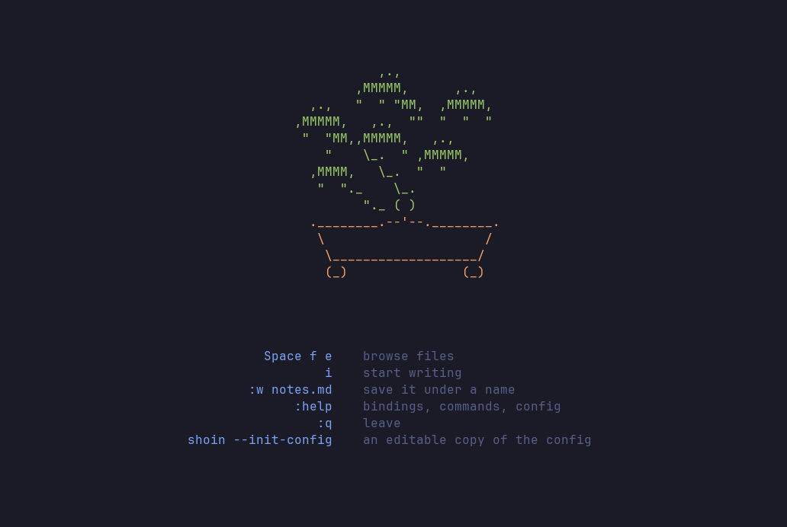

# Getting started

<p align="center">
  
</p>

Install Shoin, write the default config once, and open a file. `i` to
type, `Esc` to stop, `:w` to save, `:q` to quit.

## Install

On macOS or Linux (x86_64 or ARM), the installer downloads a prebuilt binary
from the [latest release](https://github.com/nol00p/shoin/releases/latest):

```sh
curl --proto '=https' --tlsv1.2 -LsSf https://github.com/nol00p/shoin/releases/latest/download/shoin-installer.sh | sh
```

The release page also has the plain `.tar.xz` archives, with a SHA-256
checksum for each, if you'd rather unpack the binary yourself.

With Rust 1.88 or newer, build it from crates.io instead:

```sh
cargo install shoin
```

Or from a clone:

```sh
git clone https://github.com/nol00p/shoin
cd shoin
cargo install --path .
```

Each of these puts a `shoin` binary in `~/.cargo/bin`, which needs to be on
your `PATH`. To try it without installing, `cargo run -- notes.md` works from
a clone.

Then write the default config:

```sh
shoin --init-config          # → ~/.config/shoin/*.conf
```

Do this once. Shoin starts without a config, but the leader bindings — `Space
fe` for the file tree, `Space ff` for the finder, and the rest — are defined
in it, so they do nothing until it exists. It never overwrites a config you
already have unless you add `--force`. ([Why it isn't automatic](design.md#the-config-is-one-command-not-automatic).)

## Requirements

| | |
|---|---|
| **OS** | macOS or Linux, x86_64 or ARM — Windows is not supported yet |
| **Rust** | 1.88 or newer, only to build from source |
| **Terminal** | truecolor (24-bit) support |
| **Font** | a [Nerd Font](https://www.nerdfonts.com/) — or set `glyphs.nerd_fonts = false` |
| **PDF export only** | `pandoc` and a layout engine (`brew install pandoc typst`) |

Markdown, text and HTML export need nothing beyond the binary.

## First run

```sh
shoin notes.md      # open a file (created on the first :w if it doesn't exist)
shoin               # a blank page, with a few ways in drawn on it
```

Started with no file, Shoin shows a bonsai and the ways in: the file tree, how
to start writing, how to name the file, `:help`, and how to leave. The picture
is drawn, not typed. The buffer underneath is empty, so the first key you press
is the first character of the file, and the picture is gone that same frame.

Then, in order: `i` to type, `Esc` (or `jk`) to stop, `:w` to save, `:q` to
quit. `:help` explains everything else, and `Space hl` opens one page listing
every key.

## Where next

- [Live preview](live-preview.md), the one idea the editor is built on
- [Editing](editing.md) and [Writing](writing.md) for the keys
- [Notes](notes.md) to link and compose files
