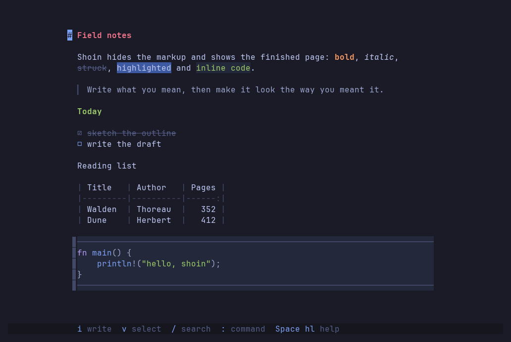

# Live preview

<p align="center">
  
</p>

The line under the cursor shows its raw Markdown. Every other line shows the
finished text, with the markers hidden and the styling applied. You always
edit exactly what is in the file, and always read what it will become.

```
  ▍A finished paragraph with bold text and a link.        ← concealed
  ▍
  ▍This is the line I am **editing** right now.           ← raw, cursor here
  ▍
  ▍ Another finished line with inline code.              ← concealed
```

> The active line is always rendered 1:1 with its source.
> Every other line may conceal its markup.

## What gets rendered

Headings, **bold**, *italic*, ~~strikethrough~~, `==highlight==`, `` `code` ``,
links and `[[wiki links]]`, `#tags`, lists with bullets and task boxes, block
quotes, tables, and fenced code. A fence that names its language is
syntax-highlighted, in seventeen languages; `:set code_syntax off` turns that
off. Inline math `$…$` turns into Unicode symbols, and a display block
between `$$` lines is laid out over several rows; the cursor on any line of
the block shows all of its TeX. See [Math](math.md).
[`examples/formatting.md`](../examples/formatting.md) exercises all of it;
[`math.md`](../examples/math.md), [`quoted-list.md`](../examples/quoted-list.md)
and [`tab-list.md`](../examples/tab-list.md) beside it show one thing each.

## Details

- In Visual mode the whole selection renders raw, so you never operate on
  markers you can't see.
- An `![[embed]]` on the cursor's line also shows its raw source, which is why
  embedded text can't be edited by accident. See [Notes](notes.md).
- A display math block counts as one line here: the cursor on any of its
  lines, or a selection touching it, shows all of it raw. When it isn't
  laid out, and why, is on the [Math](math.md#when-a-block-is-not-laid-out)
  page.
- Table rows never wrap. A row wider than the pane stays on one line and is
  clipped at the edge. Shoin lines the columns up in the file when you
  leave Insert, or on `ga`. See [Writing](writing.md#writer-verbs).
- A list inside a blockquote draws as the same list outside it, after one
  bar per `>`: the same bullet at each depth, the same indent guides, and
  the same hanging indent when an item wraps. The space after the last `>`
  belongs to the marker. A tab there is the marker's space plus
  `tab_width` − 1 columns of indent, as the list commands count it (see
  [Editing](editing.md)), and the text after it starts at the tab's stop,
  where the line draws it with the cursor on it.
- Styles nest. Emphasis, code spans and highlights inside a link's text are
  styled in the link's colour, and a link inside emphasis
  (`**see [docs](u)**`) is drawn as a link in the outer style, its address
  hidden.
- With `layout.stable_gutter` on (the default), a line's text stays in
  place when the cursor reveals its block markers: heading `#`s, quote `>`s,
  list markers, task boxes and indent guides come back to the left of the
  text, into the margin if need be. Inline markup moves nothing, even at the
  start of a line: `**Note:**` reveals at the text column, so `Note` moves
  two cells right, and a line that starts with math shows its LaTeX from the
  text column. Off, every revealed line starts at the text column.
- A compact quote such as `>>- a` or `>>text` draws like a spaced one, and
  with `layout.stable_gutter` on its text stays in place too.
- `layout.conceal = false`, `:set conceal off` or `<leader>c` turns concealment
  off entirely.
- To see every line concealed, the cursor's too, open the page read-only:
  `shoin -R` or `:view`. `shoin -p` prints that same view to the terminal.
  See [Reading](reading.md).
- Why the rule is "the cursor's line is raw": [Design notes](design.md#the-cursors-line-is-always-raw).
