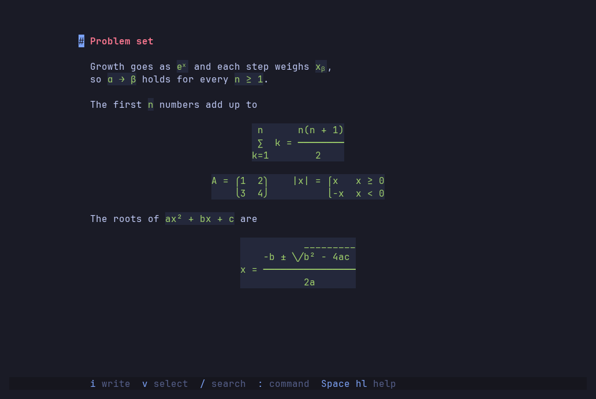

# Math

<p align="center">
  
</p>

Shoin draws LaTeX math as you write it. Inline math between single dollar
signs turns into Unicode symbols, and a display block between `$$` lines is
laid out over several rows, centred in the column. The cursor's line, or the
whole block under the cursor, shows its TeX, so you always edit what is in
the file.

## Inline math

`$…$` off the cursor's line shows Unicode: Greek letters, operators,
arrows, relations, fractions as `a⁄b`, roots as `√`, and sub- and
superscripts. A script uses Unicode letters when every character in it has
one; otherwise it is kept as written. On the cursor's line the TeX shows,
with its dollar signs.

```text
Inline: $e^x$, $x_\beta$, $A^T$, $\alpha \rightarrow \beta$, $\frac{a+b}{c}$, $\sqrt{2}$, $F_z$, $e^{i\pi}$, $\sin\theta$.
```

```text
Inline: eˣ, xᵦ, Aᵀ, α → β, (a+b)⁄c, √2, F_z, e^{iπ}, sin θ.
```

`F_z` and `e^{iπ}` stay as written: `z` has no subscript form, and `π` no
superscript form.

A `$` counts as math the way pandoc reads it: the opening `$` is followed
by a character that is not a space, and the closing `$` follows one and is
not followed by a digit. So `$5 and $6` stays plain text. Inline math ends
on the line it starts on, and `\$` is a dollar sign, not the end of the
math.

## Display math

A block opens with `$$` and closes with `$$`, on lines of their own or on
the same line as the TeX. Away from the cursor it is drawn over as many rows
as it needs, centred in the measure. Some blocks and what they draw:

```text
$$
\sum_{k=1}^{n} k = \frac{n(n+1)}{2}
$$

 n      n(n + 1)
 ∑  k = ────────
k=1        2
```

```text
$$
x = \frac{-b \pm \sqrt{b^2 - 4ac}}{2a}
$$

           _________
    −b ± ╲╱b² − 4ac
x = ────────────────
           2a
```

```text
$$
A = \begin{pmatrix} a & b \\ c & d \end{pmatrix} \qquad \det A = \begin{vmatrix} a & b \\ c & d \end{vmatrix}
$$

A = ⎛a  b⎞    det A = │a  b│
    ⎝c  d⎠            │c  d│
```

```text
$$
|x| = \begin{cases} x & x \ge 0 \\ -x & x < 0 \end{cases}
$$

|x| = ⎧x   x ≥ 0
      ⎩−x  x < 0
```

```text
$$
\begin{aligned}
(a + b)^2 &= a^2 + 2ab + b^2 \\
(a - b)^2 &= a^2 - 2ab + b^2
\end{aligned}
$$

(a + b)² = a² + 2ab + b²
(a − b)² = a² − 2ab + b²
```

The layout handles fractions, sums and products with their limits above and
below, integrals with their limits beside them, `\lim` with its limit below,
roots with an index (`\sqrt[3]{x}`), matrices, `\left( … \right)` sized to
what they hold, `cases`, `aligned` and `align`, and `\\` to stack
equations. A `$$…$$` on one line is laid out too.

## Editing a block

Put the cursor on any line of a block and all of its TeX shows, from `$$`
to `$$`. A selection that reaches into a block shows the whole block too.
Move away and the block is laid out again, with your changes.

- `j` from above lands on the block's first line, `k` from below on its
  last; inside it they move one line at a time.
- A click on any row of the layout puts the cursor on the block's first
  line.
- A search that lands inside a block shows its TeX.

## When a block is not laid out

The block's lines then show one by one, each in the one-line Unicode form
of inline math:

- It is wider than the column. Each line conceals on its own and wraps.
- It is not closed. A block with no closing `$$` ends at the next blank
  line, so a stray `$$` doesn't turn the rest of the file into math.
- It is inside a blockquote: its TeX shows as written.

An environment Shoin doesn't lay out, such as `array` or `gather*`, is drawn
inside the layout in its one-line form. Turning math off keeps every `$` as
text; turning concealment off (`layout.conceal = false`, `:set conceal off`
or `<leader>c`) shows every line raw.

## The setting

Math is on by default. The setting is `math` under `[markdown]`, which the
shipped config keeps in `input.conf` in your config folder
(`~/.config/shoin/`). To turn it off:

```toml
[markdown]
math = false
```

Saving the file applies it to the running editor. See
[Configuration](configuration.md).

## Printing and export

`shoin -p notes.md` (`--render`) prints the page with every block that
fits laid out, as the editor draws it away from the cursor. See
[Reading](reading.md).

Export does not use the editor's layout, which is for the screen only.

| Format | What happens to math |
|---|---|
| `md` | written as it is in the file |
| `txt` | the TeX, as written; inline math loses its `$` signs, display blocks keep their `$$` lines |
| `html` | MathML, which browsers draw, when `pandoc` is installed; the TeX otherwise |
| `pdf` | pandoc reads it as math; Typst and LaTeX engines typeset it |

HTML export turns each formula into MathML with `pandoc`, the same tool
PDF export needs. The page still has no script and fetches nothing. Each
formula sits in `<span class="math inline">` or
`<div class="math display">` (a `<span>` when it is inside a paragraph).

Without `pandoc` on your `PATH`, the page keeps the TeX between `\(` `\)`
and `\[` `\]`, and the export says so: `math left as TeX: no pandoc` on
the status line, or on stderr from `shoin --export`. Install pandoc from
your package manager or from pandoc.org, or add MathJax or KaTeX to the
page yourself.

With `export_follows_settings = true` and `math = false`, `txt`, `html` and
`pdf` treat `$` as a dollar sign. See [Export](export.md).

## Supported commands

- **Structure:** `\frac` `\dfrac` `\tfrac`, `\sqrt` and `\sqrt[n]`, `^`
  and `_`, `\left` and `\right` with `( ) [ ] \{ \} | \| \langle \rangle`
  or `.`, `\\` and `&`.
- **Big operators:** `\sum` `\prod` `\coprod` `\bigcup` `\bigcap`
  `\bigoplus` `\bigotimes` take limits above and below; `\int` `\iint`
  `\iiint` `\oint` take them beside. `\limits` and `\nolimits` are
  accepted and change nothing.
- **Environments:** `matrix` `pmatrix` `bmatrix` `Bmatrix` `vmatrix`
  `Vmatrix`, `cases`, `aligned` `align` `align*`, `gather`.
- **Operator names**, written upright: `\sin` `\cos` `\tan` `\log` `\ln`
  `\exp` `\det` `\gcd` and the rest of the usual set; `\lim` `\max` `\min`
  `\sup` `\inf` take a limit below. `\operatorname{…}` for your own.
- **Text and accents:** `\text` `\mathrm`, `\hat` `\vec`; `\mathbf` `\bm`
  `\boldsymbol` show their argument plain.
- **Symbols:** Greek letters, lowercase and uppercase with the `var`
  forms; arrows (`\to` `\rightarrow` `\Rightarrow` `\iff` …); relations
  (`\le` `\ge` `\ne` `\approx` `\equiv` `\sim` `\propto`); operators
  (`\times` `\cdot` `\div` `\pm` `\mp` `\circ`); sets and logic (`\in`
  `\notin` `\subset` `\subseteq` `\cup` `\cap` `\forall` `\exists` `\neg`
  `\land` `\lor`); `\infty` `\partial` `\nabla` `\hbar`; dots (`\dots`
  `\cdots` `\vdots` `\ddots`).
- **Spacing and escapes:** `\,` `\;` `\quad` `\qquad` `\!`, and `\{` `\}`
  `\$` `\%` `\&` `\#` `\_` for the character itself.

## Details

- An unknown command and its braced arguments are drawn as literal text:
  `\mathcal{F}` shows as `\mathcal{F}`, nested braces kept.
- A blank line inside a block ends it there, unclosed. Keep a block's
  lines together.
- `$$x$$ and more text` on one line is a paragraph that holds display math;
  it conceals like inline math and is not laid out.
- A block under a list item is centred in the room under the item.
- A block inside a closed fold stays folded; opening the fold shows it laid
  out.
- In a read-only view (`shoin -R`, `:view`) a layout taller than the pane
  scrolls a row at a time like any other text, so `j`, `Ctrl-d` and `G`
  reach its last row and the lines below it.
- A script that can't be written in Unicode letters keeps its `^{…}` or
  `_{…}`, with the symbols inside converted: `x^{\mathbf{\alpha t}}`
  shows `x^{α t}`.
- In an HTML export, a formula pandoc can't read keeps its TeX; the rest
  are still MathML. Math never makes an export fail.
- If pandoc fails, or hasn't finished after 10 seconds, every formula
  keeps its TeX and the export says `math left as TeX: pandoc failed` or
  `math left as TeX: pandoc timed out`.
