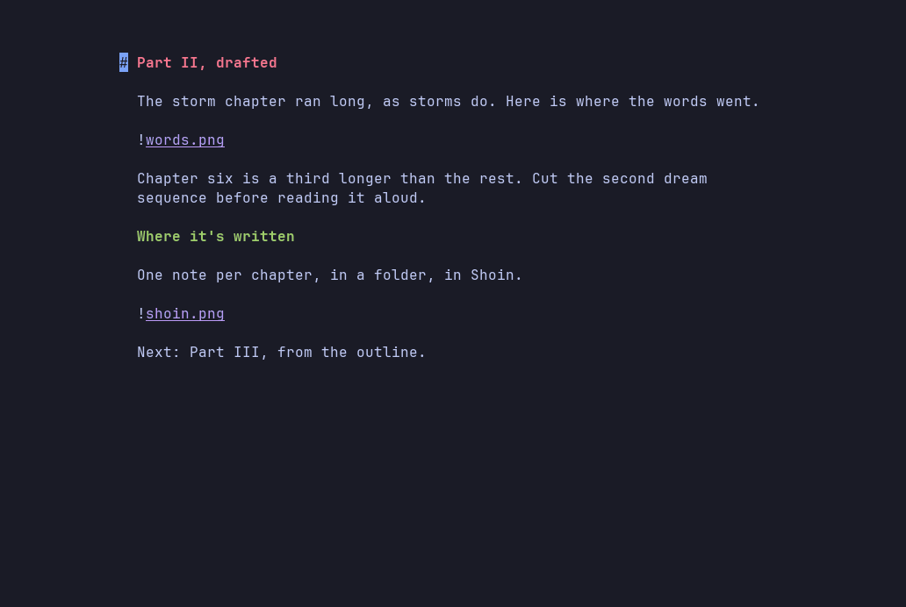

# Notes

<p align="center">
  
</p>

Write atomic ideas as separate files and compose them by ordering links.
`[[note]]` is a link, `![[note]]` embeds the note's text, and `gf` follows
either one — creating the note if it doesn't exist yet.

```markdown
# On attention

![[fragments/attention-is-scarce]]
![[fragments/the-cost-of-switching]]
![[fragments/what-i-actually-do]]
```

It's Obsidian syntax, so a vault stays portable — and moving a section becomes
`dd` `p`.

## Links and embeds

| Written | Pulls in |
|---|---|
| `![[note]]` | the whole note |
| `![[note#Heading]]` | one section of it |
| `![[note#^blockid]]` | one block |
| `[[note]]` | nothing — a plain link, styled |

`:embed` chooses how much of each embed to show on screen:

```
  :embed none     leave the link as written (the default)
  :embed short    the note's own text, in a box
  :embed rec      …and whatever it embeds, recursively
  :embed full     rec with no box — reads as one document
```

A bare `:embed` toggles off and back to the mode you last used. To write the
finished document out, see [Export](export.md).

## Following a link

`gf` opens whatever the cursor is on: a `[[note]]`, an `![[embed]]`, or the
path in a `[text](note.md)`. A `#Heading` or `#^blockid` lands on that line
rather than at the top of the note, and a name that several notes answer to
opens the finder.

**A link to a note that doesn't exist yet creates it**, empty, on disk. In a
vault you write the link first and the note second: `[[tomorrow]]` is how
tomorrow's note gets started.

`Ctrl-^` goes back to the note you came from, and again to return. It's the way
back out of a link, and how you read two notes against each other.

`gx` hands the target to the desktop instead: a URL to the browser, an
`![[photo.png]]` or a `[paper](x.pdf)` to whatever opens those. It never
creates anything.

## Pictures

`![[photo.png]]` embeds an image the same way `![[note]]` embeds a note: png,
jpg, gif, webp and bmp, found by the same rules. An image embed reserves a box
the shape of the picture, captioned with its name and pixel size. **In a
terminal that can draw pixels — kitty, Ghostty, WezTerm, iTerm2 — the picture
itself is drawn there.** Everywhere else, including inside tmux, the box and
caption stand in for it.

<p align="center">
  
</p>

`shoin -p` draws pictures too, when it prints a note into such a terminal.
See [Reading](reading.md#print-a-note).

## Worked examples

- [`examples/transclusion/`](../examples/transclusion/) covers every link
  form, including one that deliberately doesn't resolve.
- [`examples/images/`](../examples/images/) embeds one picture four ways.

## Details

- An embed on the cursor's line shows its raw source, as `**bold**` does.
  Embedded text belongs to another file, so it can't be edited from here.
- An embed shows its note as last saved, including a note `gf` just created.
- Only notes are created by `gf`. A dead `[chart](out/chart.pdf)` is reported,
  not invented.
- A bare `![[diagram]]` finds `diagram.png`, but prefers `diagram.md` if both
  exist, since that's the one you can edit.
- `SHOIN_IMAGE_PROTOCOL=kitty|iterm|none` overrides the terminal detection.
- A cycle of embeds is a hard error naming the loop, and an unresolved link
  leaves a visible placeholder rather than a silent hole in your export.
- The `[transclude]` settings set the search root, recursion depth, how far
  embedded headings are demoted, and whether embeds get a border.
