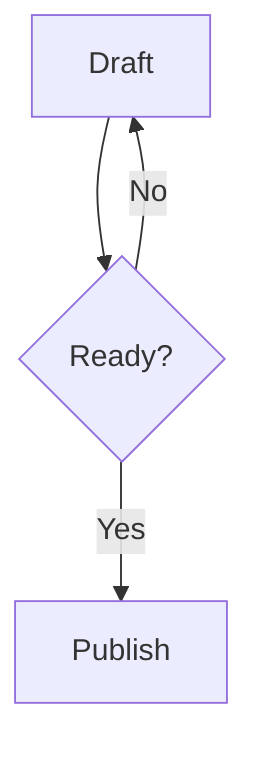
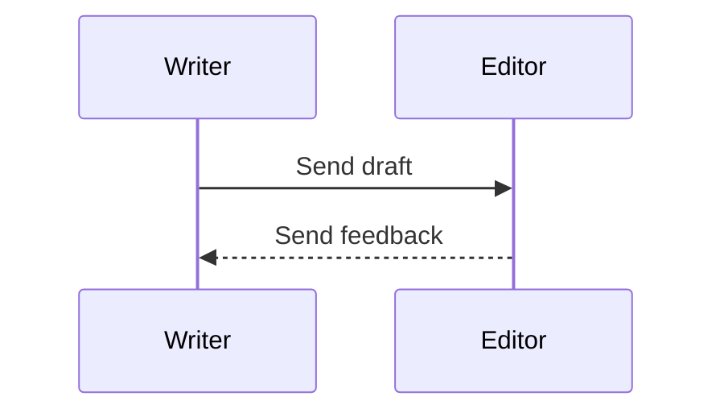

# Try Mermaid in Shoin

This README has two diagrams you can preview and edit, plus one in an embedded note.

## Start Shoin from the checkout

Run these commands from the repository root. Install `merman-cli` on PATH
first, or set `MERMAID_RENDERER` to its absolute path.

```sh
renderer=${MERMAID_RENDERER:-merman-cli}
if ! command -v "$renderer" >/dev/null; then
    echo "Install merman-cli first or set MERMAID_RENDERER." >&2
    exit 1
fi
config=$(mktemp -d /tmp/shoin-mermaid-demo.XXXXXX)
printf '[markdown]\nmermaid_renderer = "%s"\nmermaid_graphics = true\n[layout]\nconceal = true\n[transclude]\nembed = "full"\n' "$renderer" > "$config/input.conf"
cargo run --target-dir target/mermaid-demo -- --config "$config" examples/mermaid/README.md
```

`cargo run` builds and runs Shoin from this checkout using a separate build
directory for the demo. The temporary config prefers PNG previews on terminals
with graphics support. Add `-R` after `"$config"` to open read-only from the start.

## What to try

- `gg`, then search for `flowchart TD` to reveal the flowchart's source.
  Clicking a visible diagram also reveals its fence in edit mode.
- `i` edits a label. Press `Esc`, then move beyond the fence to see the
  updated diagram.
- `:view` toggles read-only mode, where previews can show under the cursor.
- `:set conceal off` shows source. Use `:set conceal on` to restore previews.
- `:q!` discards any edits you made to the demo.

If a diagram is too wide, widen the terminal. If the renderer is missing or
reports an error, the source stays visible with a diagnostic.

Try more [diagram families](families.md) or the [stress cases](stress.md).

## Flowchart



## Sequence diagram



## Diagram in an embedded note

This embed expands when your cursor leaves the link. Enable expansion with
`:embed full` if you opened the demo with a different config.

![[embedded-diagram]]


## Export this demo

With the temporary config above, run `:export html` in Shoin and choose an
output path. In the shell, use the same config to export without opening the
editor.

```sh
cargo run --target-dir target/mermaid-demo -- --config "$config" \
  --export examples/mermaid/README.md --format html --out /tmp/shoin-mermaid.html
```

Use `--format pdf` and a `.pdf` output path if you have Pandoc and a PDF
engine such as Typst.
