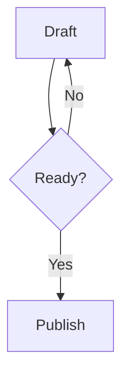
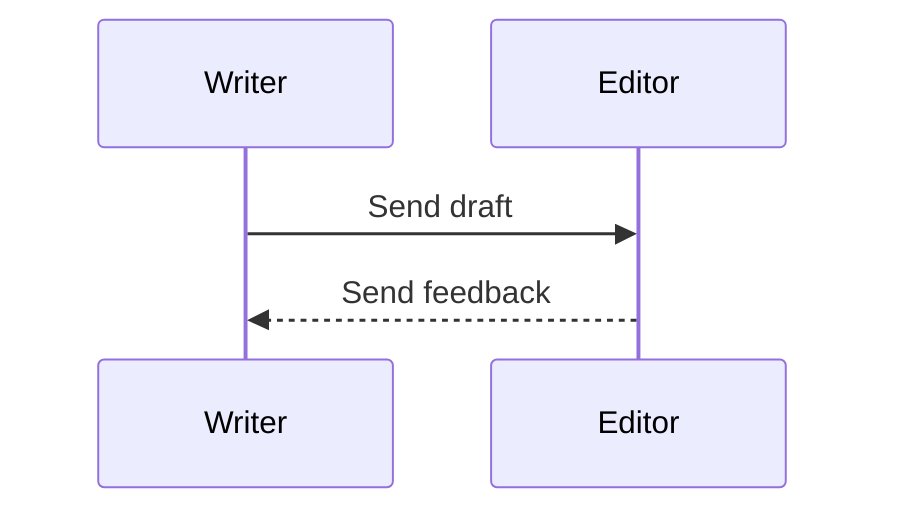

# Try Mermaid in Shoin

This README has two diagrams you can preview and edit, plus one in an embedded note.

## Start Shoin from the checkout

Run these commands from the repository root. Set `renderer` to the absolute
path of your Merman CLI if it is installed outside your PATH.

```sh
renderer=$(command -v merman-cli)
config=$(mktemp -d /tmp/shoin-mermaid-demo.XXXXXX)
printf '[markdown]\nmermaid_renderer = "%s"\nmermaid_graphics = true\n[layout]\nconceal = true\n[transclude]\nembed = "full"\n' "$renderer" > "$config/input.conf"
cargo run --target-dir /tmp/shoin-mermaid-build -- --config "$config" examples/mermaid/README.md
```

`cargo run` builds and runs Shoin from this checkout using a separate build
directory for the demo. The temporary config prefers PNG previews on terminals
with graphics support. Add `-R` after `"$config"` to open read-only from the start.

## What to try

| Shoin command | What you should see |
| --- | --- |
| `gg`, then `/`, type `flowchart` followed by a space and `TD`, then press Enter | Jump into the flowchart fence and reveal its full Mermaid source. You can also click a visible diagram to reveal its fence. |
| `i`, edit a label, then `Esc` | The source stays visible while your cursor is inside the fence. |
| `j` or `k` until you leave the fence | The diagram returns and reflects your edit. |
| `:view` | Enter read-only mode and show previews even when the cursor is on a fence. Run `:view` again to return to editing. |
| `:set conceal off` | Show the Mermaid source. Use `:set conceal on` to restore previews. |
| `:q!` | Quit and discard any edits you made to this demo. |

If a diagram is too wide, widen the terminal. If the renderer is missing or
reports an error, the source stays visible with a diagnostic.

## Flowchart



## Sequence diagram



## Diagram in an embedded note

This embed expands when your cursor leaves the link. Enable expansion with
`:embed full` if you opened the demo with a different config.

![[embedded-diagram]]


## Export this demo

With the temporary config above, run `:export html` in Shoin and choose an
output path. In the shell, use the same config to export without opening the
editor.

```sh
cargo run --target-dir /tmp/shoin-mermaid-build -- --config "$config" \
  --export examples/mermaid/README.md --format html --out /tmp/shoin-mermaid.html
```

Use `--format pdf` and a `.pdf` output path if you have Pandoc and a PDF
engine such as Typst.
